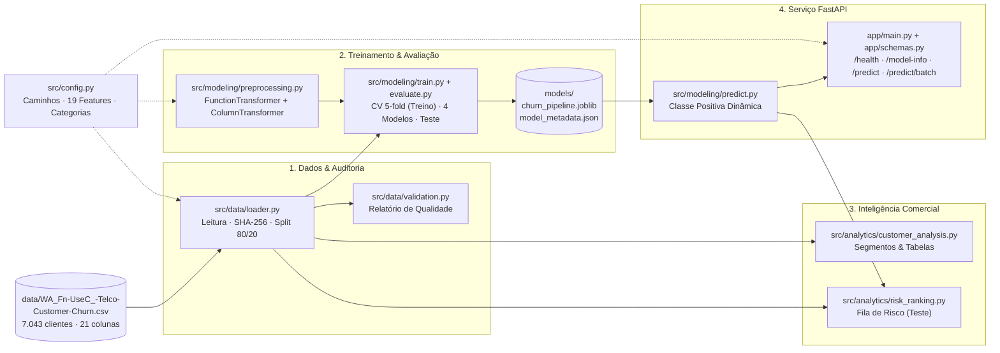

# Customer Churn Intelligence V2

Solução modular de **Machine Learning**, **Inteligência Comercial** e **API REST em FastAPI** para análise e priorização de risco de cancelamento de clientes (*customer churn*) usando o dataset **IBM Telco Customer Churn**.

> **Aviso de escopo:** Este é um projeto **demonstrativo e educacional de portfólio**, construído em ambiente local sobre a base pública da IBM. Ele **não** representa uma implantação em produção, **não** estabelece relações causais entre variáveis e churn e **não** afirma ganho financeiro ou redução comprovada de cancelamentos.

---

## 1. Problema Empresarial e Objetivo

Reter clientes em serviços recorrentes exige saber onde concentrar esforços limitados de atendimento. Este projeto busca responder, de forma auditável e reproduzível:

- Quais clientes apresentam **maior risco estimado** de cancelamento?
- Quais características contratuais, de serviços e de cobrança estão **associadas** ao churn?
- Como organizar clientes em uma **fila de priorização** ordenada por score de risco?
- Quais são as consequências práticas de **falsos positivos** e **falsos negativos**?
- O modelo supera uma **baseline simples** (`DummyClassifier`)?
- Como servir previsões individuais e em lote por meio de uma **API FastAPI** garantindo compatibilidade estrita com o treinamento?

**Objetivo da V2:** Evoluir meu estudo inicial em notebook e meu protótipo local de API para uma arquitetura única, limpa, sem *data leakage*, com auditoria reproduzível de dados, relatórios comerciais em Python/Pandas, 4 endpoints FastAPI validados por Pydantic e 60 testes automatizados em Pytest.

---

## 2. Principais Resultados Verificados

| Frente | Resultado Verificado |
| --- | --- |
| **Qualidade dos Dados** | `7.043` clientes × `21` colunas, `0` duplicatas, `0` `customerID` repetidos, SHA-256 verificado e `11` valores `" "` em `TotalCharges` (todos com `tenure = 0`) tratados dentro da `Pipeline`. |
| **Baseline vs. Modelo Final (Teste)** | `Logistic Regression` atinge **80,55%** Accuracy, **55,88%** Recall, **65,72%** Precision e **60,40%** F1-score — superando `DummyClassifier` (`73,46%` Acc / `0,00%` Recall / `0,00%` F1) e reproduzindo exatamente a baseline histórica V1. |
| **Associações Comerciais (Base Total)** | Taxa geral de churn de **26,54%** (`1.869 / 7.043`); maiores taxas associadas em `Month-to-month` (**42,71%**), `Fiber optic` (**41,89%**), `Electronic check` (**45,29%**), `0–12 meses` (**47,44%**) e no cruzamento `Month-to-month + Fiber optic` (**54,61%**). |
| **Fila de Priorização (Teste — 1.409 clientes)** | `318` clientes sinalizados (`previsao = Yes`), com receita mensal associada de **US$ 25.211,65/mês**. Na faixa operacional **Alto (`>= 0,60`)** (`209` clientes), a taxa histórica real de churn foi **71,77%**, frente a **11,90%** na faixa **Baixo (`< 0,35`)**. |
| **API e Testes Automatizados** | 4 endpoints (`GET /health`, `GET /model-info`, `POST /predict`, `POST /predict/batch`) com validação estrita nas 19 features, verificação de `modelo_sha256` e **60/60 testes passando** em Pytest. |

---

## 3. Arquitetura da Solução e Fluxo dos Dados



**Fluxo dos dados:**
1. **Auditoria (`src/data/validation.py`):** lê o CSV bruto intacto, valida SHA-256, tipos, duplicidades, `TotalCharges` inválidos, consistência de serviços e alinhamento com o schema Pydantic, exportando [`reports/data_quality_report.md`](reports/data_quality_report.md).
2. **Treinamento (`src/modeling/train.py`):** remove `customerID`, separa `80%` treino (`5.634`) / `20%` teste (`1.409`) com `random_state=42` e `stratify=y`, executa validação cruzada 5-fold **somente no treino** e salva `models/churn_pipeline.joblib` + `models/model_metadata.json` + [`reports/model_comparison.csv`](reports/model_comparison.csv).
3. **Inteligência Comercial e Fila de Risco (`src/analytics/`):** gera tabelas por segmento ([`reports/commercial_analysis_report.md`](reports/commercial_analysis_report.md)) e pontua os `1.409` clientes de teste fora da amostra de treino ([`reports/priority_risk_report.md`](reports/priority_risk_report.md)).
4. **Inferência via API (`app/main.py`):** valida JSON com Pydantic (`Literal` em todas as 15 categóricas, limites numéricos e limite máximo de `100` clientes em lote), reutiliza `src/modeling/predict.py` e identifica dinamicamente o índice de `"Yes"` em `modelo.classes_`.

---

## 4. Metodologia de Machine Learning e Comparação de Modelos

Preservo integralmente o desenho experimental da V1 (`test_size=0.20`, `random_state=42`, `stratify=y`) e adiciono a baseline `DummyClassifier(strategy="most_frequent")`. Todo o pré-processamento (`FunctionTransformer` para `TotalCharges`, `SimpleImputer(strategy="median")`, `StandardScaler` e `OneHotEncoder(handle_unknown="ignore")`) ocorre dentro da `Pipeline`, evitando *data leakage*.

> **Nota sobre o conjunto de teste histórico:** Como o split de teste (`random_state=42`) já havia sido analisado na V1, ele não é apresentado como uma avaliação inédita e **não** foi utilizado para escolher hiperparâmetros ou ajustar threshold na V2.

### 4.1 Comparação de Modelos (Validação Cruzada no Treino e Avaliação no Teste)

| Modelo | CV Treino Acc | CV Val Acc | CV Val Recall | CV Val Precision | CV Val F1 | Teste Acc | Teste Recall | Teste Precision | Teste F1 |
| --- | ---: | ---: | ---: | ---: | ---: | ---: | ---: | ---: | ---: |
| **DummyClassifier (`most_frequent`)** | 73,46% | 73,46% | 0,00% | 0,00% | 0,00% | 73,46% | 0,00% | 0,00% | 0,00% |
| **Logistic Regression (Modelo Final)** | 80,56% | **80,42%** | **54,85%** | **65,77%** | **59,80%** | **80,55%** | **55,88%** | 65,72% | **60,40%** |
| **Decision Tree (sem limite)** | 99,84% | 72,01% | 48,49% | 47,37% | 47,89% | 72,75% | 50,53% | 48,71% | 49,61% |
| **Decision Tree (`max_depth=4`)** | 79,80% | 78,72% | 47,76% | 64,23% | 54,20% | 79,21% | 45,19% | **65,76%** | 53,57% |

- A árvore sem limite apresenta forte **overfitting** (`99,84%` no treino vs. `72,01%` na validação), ficando abaixo da própria baseline `DummyClassifier` em accuracy.
- A árvore com `max_depth=4` controla o overfitting, mas entrega Recall e F1 inferiores aos da `Logistic Regression`.
- A `Logistic Regression` é mantida como modelo final, reproduzindo exatamente os resultados históricos da V1.

### 4.2 Matriz de Confusão (`Logistic Regression` no Teste — 1.409 clientes)

|  | Previsto: `No` (não churn) | Previsto: `Yes` (churn) |
| --- | ---: | ---: |
| **Real: `No` (não churn)** | **TN = 926** | **FP = 109** |
| **Real: `Yes` (churn)** | **FN = 165** | **TP = 209** |

- **Falsos Positivos (`FP = 109`):** clientes sinalizados sem cancelamento real (risco de custo operacional e oferta desnecessária).
- **Falsos Negativos (`FN = 165`):** clientes que cancelaram e ficaram abaixo do corte padrão `0,50` — principal limitação do modelo atual.

---

## 5. Inteligência Comercial e Fila de Priorização

Os relatórios completos em [`reports/commercial_analysis_report.md`](reports/commercial_analysis_report.md) e [`reports/priority_risk_report.md`](reports/priority_risk_report.md) foram construídos apenas com Python e Pandas (sem bibliotecas gráficas externas).

### Principais Associações Observadas (Base Completa — 7.043 clientes)

| Dimensão | Maior Taxa Associada | Menor Taxa Associada |
| --- | --- | --- |
| **Tipo de Contrato** | `Month-to-month`: **42,71%** (`1.655 / 3.875`) | `Two year`: **2,83%** (`48 / 1.695`) |
| **Serviço de Internet** | `Fiber optic`: **41,89%** (`1.297 / 3.096`) | `No`: **7,40%** (`113 / 1.526`) |
| **Permanência (`tenure`)** | `0 a 12 meses`: **47,44%** (`1.037 / 2.186`) | `49 a 72 meses`: **9,51%** (`213 / 2.239`) |
| **Cobrança Mensal** | `US$ 70,01 a US$ 90,00`: **37,80%** (`697 / 1.844`) | `Até US$ 35,00`: **10,89%** (`189 / 1.735`) |
| **Pagamento** | `Electronic check`: **45,29%** (`1.071 / 2.365`) | `Credit card (automatic)`: **15,24%** (`232 / 1.522`) |
| **Contrato + Internet** | `Month-to-month + Fiber optic`: **54,61%** (`1.162 / 2.128`) | `Two year + No`: **0,78%** (`5 / 638`) |

### Faixas Operacionais na Fila de Risco (Conjunto de Teste — 1.409 clientes)

| Faixa Operacional | Critério (`probabilidade_churn`) | Clientes | Prob. Estimada Média | Taxa Real Histórica no Grupo | Receita Mensal Associada (US$) |
| --- | --- | ---: | ---: | ---: | ---: |
| **Alto** | `>= 0,60` | 209 (14,83%) | 69,40% | 71,77% | 17.051,85 |
| **Moderado** | `0,35` a `0,5999` | 276 (19,59%) | 47,72% | 41,30% | 20.537,75 |
| **Baixo** | `< 0,35` | 924 (65,58%) | 10,89% | 11,90% | 52.711,60 |

> **Importante:** Probabilidade estimada não é certeza de cancelamento, e a receita mensal associada (`US$ 25.211,65/mês` nos `318` clientes com `previsao = Yes`) **não** representa perda financeira garantida nem economia comprovada.

---

## 6. API FastAPI — Exemplos Reais e Documentação Interativa

Documentação completa dos contratos e erros em [`docs/API_REFERENCE.md`](docs/API_REFERENCE.md).

### Exemplo Real · `POST /predict`

**Requisição:**

```json
{
  "tenure": 12,
  "MonthlyCharges": 70.5,
  "TotalCharges": 846.0,
  "gender": "Female",
  "SeniorCitizen": 0,
  "Partner": "No",
  "Dependents": "No",
  "PhoneService": "Yes",
  "MultipleLines": "No",
  "InternetService": "Fiber optic",
  "OnlineSecurity": "No",
  "OnlineBackup": "Yes",
  "DeviceProtection": "No",
  "TechSupport": "No",
  "StreamingTV": "No",
  "StreamingMovies": "No",
  "Contract": "Month-to-month",
  "PaperlessBilling": "Yes",
  "PaymentMethod": "Electronic check"
}
```

**Resposta real (`200 OK`):**

```json
{
  "previsao": "Yes",
  "probabilidade_churn": 0.5945508161523542,
  "probabilidade_nao_churn": 0.40544918384764583
}
```

### Exemplo Real · `POST /predict/batch` (2 clientes)

**Resposta real (`200 OK`):**

```json
{
  "total_clientes": 2,
  "previsoes": [
    {
      "previsao": "Yes",
      "probabilidade_churn": 0.5945508161523542,
      "probabilidade_nao_churn": 0.40544918384764583
    },
    {
      "previsao": "No",
      "probabilidade_churn": 0.0029748883561160184,
      "probabilidade_nao_churn": 0.997025111643884
    }
  ]
}
```

A API inclui documentação interativa local em `/docs`.

---

## 7. Como Instalar, Treinar, Executar e Testar

Recomenda-se **Python 3.12**.

```powershell
# 1. Criar e ativar o ambiente virtual (Windows PowerShell)
python -m venv .venv
.\.venv\Scripts\Activate.ps1

# 2. Instalar dependências exatas
python -m pip install -r requirements.txt

# 3. Obter o dataset conforme data/README.md e executar auditoria de qualidade
python -m src.data.validation

# 4. Treinar os modelos, validar e gerar artefatos em models/ e reports/
python -m src.modeling.train

# 5. Gerar relatórios comerciais e fila de priorização de risco
python -m src.analytics.customer_analysis
python -m src.analytics.risk_ranking

# 6. Rodar a suíte completa de 60 testes automatizados
python -m pytest -v

# 7. Subir a API local e abrir a documentação interativa
python -m uvicorn app.main:app --reload
# Acesse no navegador: http://127.0.0.1:8000/docs
```

*(No Linux/macOS, ative o ambiente com `source .venv/bin/activate`.)*

> **Segurança e integridade de artefatos:** Arquivos `.joblib` utilizam serialização `pickle` do Python internamente e podem executar código arbitrário se forem adulterados. Carregue exclusivamente o artefato gerado por `python -m src.modeling.train` ou proveniente de fonte explicitamente confiável. A API valida automaticamente a correspondência entre `models/churn_pipeline.joblib` e `models/model_metadata.json` (`modelo_sha256`, etapas, classes e features) e não expõe caminhos locais em respostas HTTP de erro.

> **Dataset:** amostra atribuída à IBM. O CSV não integra a árvore atual; instruções de obtenção, verificação e condições estão em [`data/README.md`](data/README.md).

---

## 8. Estrutura do Repositório

```text
customer-churn-ml/
├── app/
│   ├── __init__.py
│   ├── main.py                      # FastAPI: /health, /model-info, /predict, /predict/batch
│   └── schemas.py                   # Contratos Pydantic (15 Literal + limites numéricos e de lote)
├── src/
│   ├── config.py                    # Fonte única de caminhos, features, categorias e parâmetros
│   ├── data/
│   │   ├── loader.py                # Carregamento validado, SHA-256 e split estratificado
│   │   └── validation.py            # Auditoria reproduzível e relatório de qualidade
│   ├── modeling/
│   │   ├── preprocessing.py         # FunctionTransformer + ColumnTransformer + Pipeline
│   │   ├── evaluate.py              # CV no treino, métricas no teste e exportação
│   │   ├── train.py                 # Treinamento dos 4 modelos e salvamento do artefato final
│   │   └── predict.py               # Carregamento seguro e inferência com classe positiva dinâmica
│   └── analytics/
│       ├── customer_analysis.py     # Análises comerciais por segmento
│       └── risk_ranking.py          # Fila de priorização no conjunto de teste
├── data/                            # instruções para obtenção local do CSV e atribuição IBM
├── models/                          # churn_pipeline.joblib + model_metadata.json
├── notebooks/                       # customer_churn_analysis.ipynb (V1 preservado integralmente)
├── reports/                         # Relatórios agregados Markdown/CSV/JSON
├── tests/                           # 60 testes em Pytest (dados, ML, analytics, schemas e API)
├── docs/                            # Arquitetura, dicionário, metodologia, API, guias e auditoria
├── INTERVIEW_NOTES.md               # Folha de revisão rápida V1 preservada
├── README.md
├── requirements.txt
├── .gitattributes                   # Preservação canônica de fim de linha LF do dataset e textos
└── .gitignore
```

---

## 9. Documentação e Material de Aprendizagem

- [`docs/ARCHITECTURE.md`](docs/ARCHITECTURE.md) — Arquitetura ponta a ponta e decisões de engenharia
- [`docs/DATA_DICTIONARY.md`](docs/DATA_DICTIONARY.md) — Dicionário completo das 21 colunas e auditoria de qualidade
- [`docs/METHODOLOGY.md`](docs/METHODOLOGY.md) — Metodologia de ML, anti-leakage e interpretação das métricas
- [`docs/API_REFERENCE.md`](docs/API_REFERENCE.md) — Referência completa dos endpoints, schemas e códigos HTTP

---

## 10. Limitações

- **Recall limitado (`55,88%`):** `165` clientes que cancelaram no conjunto de teste não foram classificados como `"Yes"` no threshold padrão `0,50`.
- **Avaliação em split histórico único:** o conjunto de teste já era conhecido na V1; estudos futuros exigem validação temporal ou dados inéditos.
- **Associação sem causalidade e sem comprovação financeira:** os números comerciais não provam causas de cancelamento nem retorno econômico de ações de retenção.
- **Escopo de portfólio local:** sem banco de dados, autenticação, monitoramento de drift ou implantação em produção.

---

## 11. Minha Contribuição e Assistência de IA

- **Minha participação:** Construí originalmente a versão V1 do estudo de classificação no notebook (`customer-churn-ml`) — definindo a preparação de `TotalCharges`, o pré-processamento em `Pipeline`, a validação cruzada comparando `LogisticRegression` e `DecisionTreeClassifier` e a avaliação final — além do protótipo inicial da API em FastAPI (`churn-prediction-api`) com Pydantic e Pytest. Na evolução V2, defini os requisitos empresariais, as restrições técnicas compatíveis com meu estágio atual de aprendizado e aprovei explicitamente os poucos recursos adicionais necessários.
- **Assistência de IA:** Utilizei assistência de IA como mentoria técnica na V2 para auditar os dois projetos anteriores, corrigir os bugs identificados, unificar o código em módulos reutilizáveis (`src/`, `app/`, `tests/`), implementar a camada de inteligência comercial e fila de risco, validar todos os fluxos em execução real e elaborar a documentação e os guias de estudo. Não apresento a parte estruturada com apoio de IA como domínio autônomo já consolidado; continuo estudando e praticando para reconstruir o sistema com autonomia.

---

## Autor

**Luan Gabriel** · Estudante de Inteligência Artificial e Machine Learning na UNIASSELVI · [GitHub](https://github.com/LuanGabriel12)
