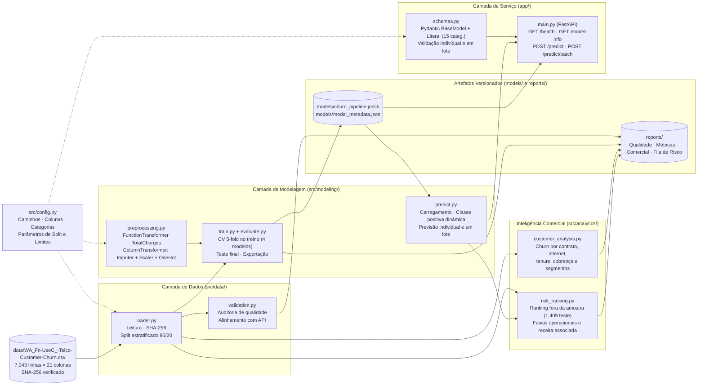

# Arquitetura da Solução — Customer Churn Intelligence V2

Este documento descreve a arquitetura técnica, os módulos, o fluxo de dados e as decisões de engenharia da evolução **V2** do projeto **Customer Churn Intelligence**.

---

## 1. Visão Geral e Princípios Arquiteturais

O objetivo da arquitetura V2 foi unificar dois esforços anteriores — o notebook analítico (`customer-churn-ml`) e o protótipo isolado de API (`churn-prediction-api`) — em um único repositório modular, testável e reproduzível, mantendo **simplicidade técnica deliberada**:

- **Código procedural modular:** funções simples e diretas organizadas por responsabilidade (`src/data/`, `src/modeling/`, `src/analytics/`, `app/`), sem design patterns complexos, classes artificiais ou infraestrutura desnecessária.
- **Fonte única de verdade (`src/config.py`):** caminhos portáveis (`Path(__file__).resolve().parents[1]`), lista das 19 features, categorias válidas, parâmetros de split (`test_size=0.20`, `random_state=42`) e limite de lote (`100`) ficam centralizados em um único arquivo.
- **Zero duplicação entre treino e inferência:** tanto a fila de priorização (`src/analytics/risk_ranking.py`) quanto os endpoints FastAPI (`app/main.py`) utilizam exatamente as mesmas funções de `src/modeling/predict.py` e o mesmo artefato serializado (`models/churn_pipeline.joblib`) gerado por `src/modeling/train.py`.
- **Preservação da V1:** o notebook original (`notebooks/customer_churn_analysis.ipynb`), e o resumo original (`INTERVIEW_NOTES.md`) foram preservados. O CSV deve ser obtido localmente conforme `data/README.md`.

---

## 2. Diagrama da Arquitetura Ponta a Ponta



---

## 3. Estrutura do Repositório e Responsabilidade de Cada Módulo

```text
customer-churn-ml/
├── app/
│   ├── __init__.py                   # Inicializador correto do pacote app
│   ├── main.py                       # Endpoints FastAPI (/health, /model-info, /predict, /predict/batch)
│   └── schemas.py                    # Contratos Pydantic (ClienteChurn, RespostaChurn, lote, saúde, info)
├── src/
│   ├── __init__.py
│   ├── config.py                     # Configurações e constantes compartilhadas (paths portáveis)
│   ├── data/
│   │   ├── loader.py                 # Leitura validada do CSV, SHA-256, separação X/y e split 80/20
│   │   └── validation.py             # Auditoria completa de qualidade e exportação de relatório Markdown
│   ├── modeling/
│   │   ├── preprocessing.py          # corrigir_total_charges, ColumnTransformer e fábrica de Pipeline
│   │   ├── evaluate.py               # Validação cruzada no treino, avaliação no teste e exportação
│   │   ├── train.py                  # Treinamento dos 4 modelos e geração de churn_pipeline.joblib + metadados
│   │   └── predict.py                # Carregamento seguro, índice dinâmico de classes e previsão unitária/lote
│   └── analytics/
│       ├── customer_analysis.py      # Análises comerciais descritivas em Python/Pandas + relatório executivo
│       └── risk_ranking.py           # Fila de priorização no teste (1.409 clientes) e receita associada
├── data/
│   ├── README.md                     # Origem, licença Apache 2.0 e hash SHA-256
│   └── WA_Fn-UseC_-Telco-Customer-Churn.csv
├── models/
│   ├── churn_pipeline.joblib         # Pipeline completa serializada (com FunctionTransformer)
│   └── model_metadata.json           # Metadados verificáveis (versões, SHA-256, métricas, features)
├── notebooks/
│   └── customer_churn_analysis.ipynb # Notebook original V1 preservado integralmente
├── reports/
│   ├── data_quality_report.md        # Relatório reproduzível de auditoria de dados
│   ├── model_comparison.csv          # Tabela comparativa de CV e teste dos 4 modelos
│   ├── model_metrics.json            # Métricas completas e matrizes de confusão em JSON
│   ├── commercial_analysis_report.md # Relatório comercial (associações observadas)
│   ├── churn_by_segment.csv          # Base consolidada dos segmentos comerciais
│   ├── priority_risk_report.md       # Relatório executivo da fila de risco e receita associada
├── tests/
│   ├── conftest.py                   # Fixtures de clientes válidos, TestClient e simulação de indisponibilidade
│   ├── test_data_validation.py       # Testes de carregamento, integridade SHA-256 e auditoria
│   ├── test_preprocessing_and_model.py # Testes de pré-processamento, anti-leakage, métricas e regressões
│   ├── test_analytics.py             # Testes das análises comerciais e ordenação da fila de risco
│   ├── test_schema.py                # Testes dos contratos Pydantic (incluindo regressões corrigidas da V1)
│   └── test_api.py                   # Testes de integração dos 4 endpoints, erros 422/503 e OpenAPI
├── docs/                             # Documentação técnica, guia de estudos, desafios e auditoria
├── INTERVIEW_NOTES.md                # Revisão rápida original V1 preservada
├── README.md                         # Apresentação executiva e técnica do projeto
├── requirements.txt                  # Dependências exatas verificadas
└── .gitignore
```

---

## 4. Fluxo dos Dados (Treinamento vs. Inferência na API)

### 4.1 Fluxo de Treinamento (`python -m src.modeling.train`)
1. `carregar_dataset()` lê `data/WA_Fn-UseC_-Telco-Customer-Churn.csv`, valida as 21 colunas obrigatórias e verifica o hash SHA-256.
2. `separar_features_e_alvo()` remove `customerID` (identificador sem valor preditivo) e separa `X` (19 features) e `y` (`Churn`).
3. `dividir_treino_e_teste()` aplica `train_test_split(test_size=0.20, random_state=42, stratify=y)` -> **5.634** linhas de treino e **1.409** de teste.
4. Para cada um dos 4 candidatos (`DummyClassifier`, `LogisticRegression`, `DecisionTreeClassifier`, `DecisionTreeClassifier(max_depth=4)`):
   - `criar_pipeline_modelo()` cria uma `Pipeline` com 3 passos: `corrigir_total_charges` -> `preprocessador` -> `modelo`.
   - `avaliar_validacao_cruzada()` roda `cross_validate(..., cv=5, return_train_score=True)` **exclusivamente** em `(X_train, y_train)`.
   - `pipeline.fit(X_train, y_train)` ajusta a mediana do `SimpleImputer`, média/desvio do `StandardScaler`, categorias do `OneHotEncoder` e pesos do modelo apenas no treino.
   - `avaliar_no_teste()` avalia sobre `(X_test, y_test)` para registro transparente.
5. A pipeline final (`Logistic Regression`) é salva em `models/churn_pipeline.joblib` acompanhada de `models/model_metadata.json`, `reports/model_comparison.csv` e `reports/model_metrics.json`.

### 4.2 Fluxo de Inferência na API (`POST /predict` e `POST /predict/batch`)
1. FastAPI recebe o JSON e valida contra `ClienteChurn` (ou `LoteClientesChurn`, com `min_length=1` e `max_length=100`).
2. Campos ausentes, negativos, `SeniorCitizen` fora de `{0, 1}` ou categorias fora dos `Literal[...]` são rejeitados automaticamente com **HTTP 422**.
3. `obter_modelo_carregado()` verifica se o artefato está carregado em memória; se indisponível, retorna **HTTP 503**.
4. `prever_cliente()` / `prever_lote()` converte os dados em `DataFrame` na ordem exata de `COLUNAS_FEATURES`, executa `modelo.predict()` e `modelo.predict_proba()`, consulta dinamicamente a posição de `"Yes"` e `"No"` em `modelo.classes_` e retorna a resposta no contrato `RespostaChurn`.

---

## 5. Decisões de Engenharia Relevantes

| Decisão | Alternativa Descartada | Justificativa Técnica |
| --- | --- | --- |
| Função `corrigir_total_charges` em módulo importável (`src.modeling.preprocessing`) | Função definida dentro de célula de notebook (`__main__`) | Permite serializar e carregar a pipeline inteira via `joblib` em qualquer script ou API sem perder a conversão de `TotalCharges`. |
| Validação estrita com `Literal` nas 15 colunas categóricas + `handle_unknown="ignore"` na pipeline | Deixar 14 colunas como `str` livre (como na API original) | Evita que erros de digitação (ex.: `"Pix"` ou `"Monthly"`) passem silenciosamente zerando colunas one-hot; mantém o encoder resiliente como segunda camada de defesa. |
| Carregamento tolerante a falhas em `app/main.py` (`inicializar_modelo`) + HTTP `503` | `joblib.load("models/churn_pipeline.pkl")` solto na importação | Evita quebra na importação, valida a correspondência (`modelo_sha256`, etapas, classes e features) entre `.joblib` e `model_metadata.json` e retorna HTTP `503` seguro sem vazar caminhos locais. |
| Preservação canônica `LF` em `.gitattributes` | Depender de `core.autocrlf` do sistema operacional | Impede que o Git ou `git archive` no Windows converta `LF` em `CRLF` no CSV bruto e altere o hash SHA-256. |
| Restrição de procedência de artefatos `.joblib` | Carregar arquivos `.pkl`/`.joblib` de origem desconhecida | `joblib.load` usa `pickle` internamente e pode executar código arbitrário se ler arquivos não confiáveis; somente artefatos gerados por `src/modeling/train.py` (ou fontes confiáveis) devem ser carregados. |
| Caminhos resolvidos via `Path(__file__).resolve().parents[1]` | Strings relativas fixas (`"models/..."`) | Garante execução idêntica a partir de qualquer diretório de trabalho e em qualquer computador. |
| Fila de priorização calculada sobre `X_test` (`1.409` clientes) | Ranquear a base de treino | Evita viés otimista de pontuar exemplos vistos durante o `fit`. |
| Sem banco de dados, Docker, Redis ou frontend | Infraestrutura complexa desnecessária | Foco total na correção estatística, contratos de API, testes reais e clareza de código. |
